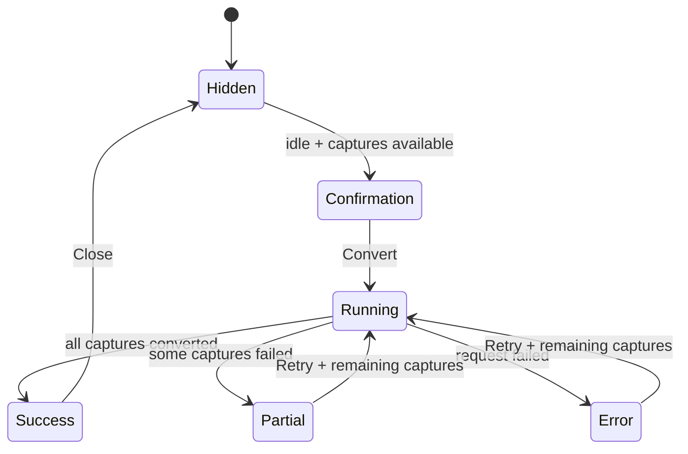

# Confirmation dialog → background progress

Use this pattern for an operation that needs an informed decision before starting, then can run while the user continues using RaceIQ. Sparse recording conversion is the reference implementation. This document captures its existing behavior and a composition recipe; it does not introduce a shared component or change runtime behavior.

Do not use it for short requests that only need a disabled button, tasks that require continuous user input, or operations that actually block the app. Only promise background availability when the backend supports it.

## Implementation map

- [`CaptureMigration`](../../client/src/components/CaptureMigration.tsx): centered confirmation, bottom-right progress/result, and inline maintenance view.
- [`CaptureMigrationState` and store actions](../../client/src/stores/telemetry.ts): operation status and counters shared across views.
- [`useWebSocket`](../../client/src/hooks/useWebSocket.ts): status restoration on connection and migration events.
- [`AppShell`](../../client/src/routes/__root.tsx): root-level mounting and recording-layout migration precedence.
- [`ProcessingMaintenance`](../../client/src/components/ProcessingMaintenance.tsx): the inline `<CaptureMigration compact />` consumer.
- [`RecordingLayoutMigration`](../../client/src/components/RecordingLayoutMigration.tsx): related flow with a destination choice, deferral, and a docked progress bar. Its policy is not identical to sparse conversion.
- [`Dialog` primitives](../../client/src/components/ui/dialog.tsx) and [`Button`](../../client/src/components/ui/button.tsx): shared interaction and control building blocks.

## Sparse conversion lifecycle

The diagram shows the normal unsuppressed flow. Server restoration can enter an existing operation state directly. Visibility is a separate decision from operation status:

- `required = Boolean(available && available.captureCount > 0)`.
- `running = progress.status === "running"`.
- `compactProgress = progress.status !== "idle"`.
- `dialogOpen = required || running || (progress.status === "success" && !successDismissed)`.
- `suppressed` hides this component without resetting operation state.

Consequences: only `idle` uses the centered modal. Every non-idle state uses the docked presentation when open. Partial/error alone do **not** keep the sparse dialog open; remaining available captures do. Success dismissal is local to each mounted component instance, not persisted or shared. In the exceptional case that availability still reports work after success, `required` continues to keep the dialog open.

Starting checks the shared store again: no captures or an already-running operation means no submission. `beginCaptureMigration` immediately resets counters and enters `running`, before the POST resolves. There is no Cancel, Later, generic close icon, or explicit outside/Escape dismissal handler in the sparse flow. Do not infer cancellation from hiding the panel.

## Presentation contract

| Surface | Interaction | Content and placement |
| --- | --- | --- |
| Confirmation | `Dialog modal={true}`, controlled `open`, `showCloseButton={false}` | Centered `DialogContent size="md"`; upgrade icon, title, description, available-capture count, benefit and fidelity caveat, full-width Convert button. Overlay uses `bg-app-bg/80`. |
| Running | `Dialog modal={false}`, hidden overlay, no action button | Fixed bottom-right, `right-4 bottom-4 w-72`, reset centered transforms, `size="sm"`, `p-4`, compact title with spinning icon; background-availability explanation and `done / total` status text. The sparse dock has **no visual progress bar**. |
| Success | Same non-modal dock | Success icon and converted count in the title; explicit Close button, no auto-dismiss timer. |
| Partial/error | Same non-modal dock, subject to visibility rules above | Failure summary or error with `role="alert"`; Retry button when captures remain. |
| Inline maintenance | Section, not a docked dialog | Heading, manual Refresh, availability, running count and percentage with progress bar, failure/success text, Convert/Retry when work remains. |

`compact` selects the inline maintenance surface; it does **not** mean the bottom-right panel. `compactProgress` is the internal presentation switch for the latter.

Keep title, description, counts, benefit/caveat, background message, progress label, and action labels localized through Paraglide. Icons are decorative (`aria-hidden="true"`); text conveys status. Use existing `app-*` surface/text/accent roles and `status-*` outcome roles, not telemetry severity colors.

## State and transport ownership

The sparse operation state is `{ status, done, total, migrated, failed, error }`, where status is `idle | running | success | partial | error`. Availability is separate (`sessionCount`, `captureCount`). `done` counts processed captures, including failures; it is not the successful-conversion count.

1. `GET /api/sessions/capture-migration-status` restores availability and operation progress when the WebSocket connects. The inline Refresh action uses the same endpoint. Connection refresh is best-effort; maintenance provides a visible manual retry path.
2. `POST /api/sessions/migrate-captures` starts conversion through typed Hono RPC. The feature owns submission and error mapping; dialog primitives do not know endpoints.
3. `capture-migration-available` and `capture-migration-progress` messages update the shared telemetry store. Incremental progress only updates a running state; `done` never decreases (`Math.max`). Each incremental outcome updates migrated/failed counters. Terminal WebSocket snapshots restore final state.
4. The POST result finalizes success or partial failure, then refreshes server status. Request failure enters `error` with a localized message.
5. The inline progress percentage is `total > 0 ? Math.round(done / total * 100) : 0`. Its progressbar exposes a translated label, min `0`, max `total`, current `done`, and percentage value text.

Reconnect restores server-reported progress; this is not a promise that a browser owns the task or that all state survives a server restart. Keep local presentation state (dismissal) separate from authoritative job state.

## Reuse recipe

Compose the existing primitives rather than importing `CaptureMigration` into an unrelated feature:

1. Define feature-owned availability, operation status, submission, retry policy, and server status restoration. Use the existing global WebSocket path when appropriate; do not create component-owned sockets or put unrelated jobs in capture-migration state.
2. Mount the global presentation in the app shell, outside individual route pages, so navigation does not remove its presenter. Keep an inline maintenance entry point for refresh and recovery when the global prompt is hidden or deferred.
3. Derive `open` and `docked` separately. Before consent: `Dialog modal={true}` and centered `DialogContent size="md"`. After start: `modal={false}`, `overlayClassName="hidden"`, `size="sm"`, bottom-right positioning, and zero centered transforms. Changing only CSS position would leave a background task modal.
4. Supply feature-specific title, description, benefits, caveats, progress units, terminal summary, and actions through composition. Keep counts factual. Do not claim percent complete when the total is unknown; show indeterminate activity instead.
5. Disable duplicate submissions immediately. Keep completion visible until explicit dismissal. Decide whether failed/partial work remains visible even when availability cannot be fetched; sparse conversion's current availability-dependent policy is not a universal requirement.
6. Make deferral, dismissal, and cancellation distinct. Add Later only when deferral is supported. Add Cancel only with a real backend cancellation contract. Decide whether dismissal is session-local or persistent.
7. Coordinate dock ownership before adding another global operation. Currently recording-layout migration suppresses sparse conversion while layout work exists, is running/partial/error, or has an undismissed success. This is feature-specific precedence, not a general queue or stacking manager.

For new docks, use viewport-safe width such as the layout migration's `w-[min(24rem,calc(100%-2rem))]`, a scrollable maximum height, and wrapping for long paths. Preserve the current sparse implementation as evidence, not a license to copy incidental styling: it includes `shadow-xl`, while the [design system](../../client/DESIGN.md) prefers tonal separation over decorative shadows.

### Accessibility and verification

Use `DialogTitle`/`DialogDescription` for the confirmation and an accessible title for the dock. Keep completion/progress text in `role="status"` and errors in `role="alert"`. If a progress bar is present, expose the real counters and a translated label. Do not rely on spinner, color, or percentage alone.

For each consuming feature, exercise confirmation → start → background interaction/navigation → completion → Close, plus partial failure → Retry and request failure. Check server-status restoration, zero/unknown totals, duplicate-start prevention, suppression ordering, and the inline maintenance entry point. Verify keyboard focus remains usable when switching from modal to non-modal; a hidden overlay alone is not proof. Inspect narrow viewport fit, long localized copy, and long paths where applicable.

### Component extraction boundary

Today this is a documented composition pattern, not an exported `BackgroundOperation` component. Sparse and layout migrations differ in choices, deferral, visibility, progress visualization, and transport. A future extraction should share only a proven presentation contract: centered/docked shell, title/description/content/actions, and accessible progress display. Keep RPC, WebSocket handling, job state, retry semantics, and operation priority feature-owned. Migrate real consumers together and remove their obsolete shells rather than adding a second dialog convention.
